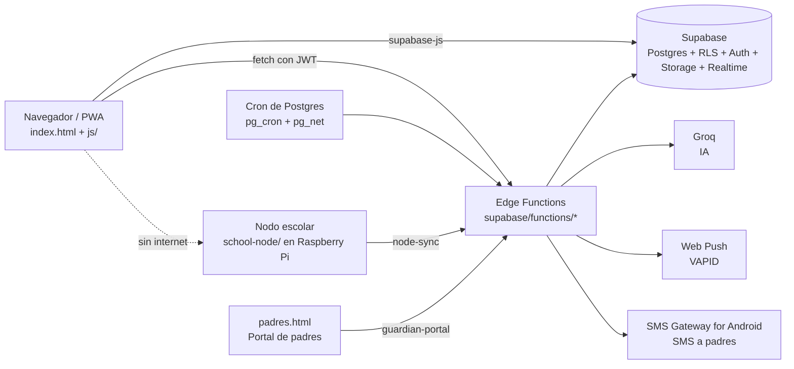

# Arquitectura de Quetzal LMS

Este documento explica cómo está armado el sistema para que una persona nueva
pueda ubicarse en el código en una tarde. Para instalarlo ver
[SETUP.md](SETUP.md); para colaborar, [CONTRIBUTING.md](../CONTRIBUTING.md).

## Vista general

| Capa | Dónde | Tecnología |
|---|---|---|
| Interfaz | `index.html`, `js/`, `css/` | JavaScript sin framework (módulos ES + funciones en `window`), Tailwind compilado |
| Modo sin conexión | `service-worker.js`, `js/offline-kit.js`, `js/sync-manager.js` | Service worker con caché, IndexedDB/localStorage |
| Base de datos y seguridad | Supabase (Postgres) | Reglas por fila (RLS), permisos por columna, funciones `SECURITY DEFINER` |
| Lógica de servidor | `supabase/functions/` (única fuente de verdad, ADR-001) | Deno (Edge Functions) |
| Nodo escolar | `school-node/` | Node.js + better-sqlite3 en Raspberry Pi 4 |
| Portal de padres | `padres.html` | HTML autocontenido, sin librerías |
| Hosting | GitHub Pages | `clases.yoaprendo.online` y `billiog.github.io/proyectoX/` |

No hay paso de compilación para el JavaScript: lo que está en `js/` es lo que
se publica. El único paso de build es Tailwind (`css/tailwind.src.css` →
`css/tailwind.css`).

## Arranque de la aplicación

1. `index.html` carga Supabase, `js/config.js` (URL y clave pública) y `js/app.js`. Desde v1.0.260 no hay `<script>` en línea: lo que antes estaba escrito en `index.html` vive en `js/boot.js` y `js/version.js`, y los botones (`onclick`) los ejecuta `js/safe-handlers.js` (ver «Seguridad»).
2. `app.js` importa los módulos base y llama a `initAuth()` (`js/auth.js`).
3. `initAuth()` decide el modo:
   - **Nodo escolar**: si la app se abrió desde una Raspberry con la réplica lista (`window.QUETZAL_NODE.rest`), `js/config.js` apunta el cliente de Supabase al propio nodo y corre la **app real** sin internet (ver `school-node/README.md`). Si la réplica aún no está lista (o con `/?modo=pin`), `detectQuetzalNode` activa el modo anterior de `js/node-mode.js`.
   - **Sesión en la nube**: `handleSuccessfulLogin()` carga el perfil desde `teachers` o `students` y fija el rol.
   - **Sin conexión**: usa las cuentas guardadas en la tablet (`js/offline-kit.js`).
4. `nav(vista)` (en `js/main.js`) muestra la sección y carga sus módulos bajo demanda con `loadModule()` según `MODULE_MAP`.

## Roles

| Rol | Tabla | Qué puede hacer |
|---|---|---|
| `admin` | `teachers.role = 'admin'` | Todo: escuelas, docentes, alumnos, reportes, avisos globales |
| `coordinador` | `teachers.role = 'coordinador'` | Ve a los docentes que el admin le asignó |
| `docente` | `teachers` | Sus clases (`teacher_assignments`): alumnos, asistencia, evaluación, cursos, avisos, padres |
| `estudiante` | `students` | Cursos, proyectos, Centro de Juego, perfil |
| Padre o encargado | `student_guardians` (sin cuenta) | Portal de padres con enlace personal |

El rol **siempre** se decide en el servidor con las tablas, nunca con datos que
manda el navegador.

## Módulos del cliente (`js/`)

### Base
| Archivo | Responsabilidad |
|---|---|
| `app.js` | Punto de entrada |
| `main.js` | Navegación, `MODULE_MAP` y carga perezosa de módulos |
| `config.js` | URL y clave pública de Supabase, grados, niveles, secciones |
| `auth.js` | Login, sesión, rol, cierre de sesión |
| `utils.js` | `sanitizeInput`, `fetchWithCache`, `fetchAllRows`, grados, toasts |
| `sync-manager.js` | Caché local y cola de cambios sin conexión |
| `offline-kit.js` | Varias cuentas por tablet, PIN, almacenamiento persistente |
| `node-mode.js` | Modo nodo escolar anterior (PIN y panel del nodo), disponible en `/?modo=pin` |
| `node-sync-chip.js` | Aviso «Sincronizado hace X / N cambios por subir» y botón «Sincronizar ahora» (solo sobre el nodo) |
| `school-node/content-upload.js`, `multipart.js`, `content-sync.js` | Subida de archivos de cursos al nodo (Storage emulado) y a la nube; `supabase/functions/node-sync/content.ts` valida los cursos y recursos que sube un nodo |
| `supabase/functions/node-sync/social.ts`, `school-node/rest/profanity.js` | Comentarios, «me gusta» y notas de recursos hechos en el nodo: validación en la nube y filtro de groserías (el mismo de la nube) |
| `supabase/functions/node-sync/attendance.ts`, `groups.ts`, `school-node/rest/progress.js` | Asistencia y equipos hechos en el nodo (validación en la nube) y progreso de práctica calculado en el nodo |
| `notification-center.js` | Refresca los contadores (campana, evaluar, duelos) |
| `activity-tracker.js` | Tiempo activo (latido cada 30 s, calculado en servidor) |
| `boot.js`, `version.js` | Arranque y número de versión (antes eran `<script>` en línea de `index.html`) |
| `safe-handlers.js`, `handler-allowlist.js`, `openers.js` | Ejecución de los `onclick` bajo la CSP: un intérprete mínimo que solo llama a las funciones de la lista permitida (`handler-allowlist.js`, generada con `node scripts/handlers-audit.mjs --write`); `openers.js` agrupa funciones con nombre para botones asíncronos |
| `query-cache.js`, `private-media.js` | Caché con vigencia y direcciones firmadas para fotos y videos privados |

### Aprendizaje
| Archivo | Responsabilidad |
|---|---|
| `lessons.js` | Cursos, recursos (PDF, video, H5P, SCORM, quiz), reproductor, progreso |
| `weekly-topic.js` | Tema de la semana y reporte de duelos para el docente |
| `projects.js`, `project-modals.js`, `feed-ui.js` | Proyectos de los alumnos y feed |
| `evaluation*.js` | Evaluación de proyectos con rúbrica e IA |
| `groups.js` | Equipos de proyecto |
| `attendance*.js` | Asistencia por QR |
| `ai-service.js` | Cliente de `ai-proxy` |
| `mascot-widget.js` | Asistente Quetzal (oculto en pantallas evaluativas) |

### Gamificación
| Archivo | Responsabilidad |
|---|---|
| `gamification.js` | Centro de Juego, cofre diario, gemas en vivo, guía de gemas |
| `game-arena.js` | Capa común de los juegos 1v1 (VS, resultados, retos rápidos, presencia) |
| `duels.js`, `hangman-duel.js`, `timed-math-duel.js`, `debug-duel.js`, `spelling-duel.js` | Los 5 juegos 1v1 |
| `exams.js`, `omr-core.js` | Exámenes con hoja de respuestas: crear, imprimir hojas con QR por alumno, escanear con la cámara y calificar (lector de burbujas sin dependencias) |
| `companion.js` | Mascotas, Quetzadex, trucos (emotes en el código), vestidor, tarjeta para redes, videos |
| `season-pass.js`, `leagues.js`, `tournaments.js`, `random-events.js` | Pase, ligas, torneos, eventos sorpresa |
| `badges.js`, `ranking.js`, `certificates.js` | Insignias, ranking, diplomas |

### Gestión
| Archivo | Responsabilidad |
|---|---|
| `students.js` | Alumnos, contraseñas de clase, alta por docentes, padres |
| `teachers.js`, `coordinator.js` | Docentes, asignaciones, coordinación |
| `schools.js`, `programs.js` | Establecimientos y programas |
| `pdf-processor.js` | Importación de nóminas del SIRE (PDF) |
| `announcements.js`, `surveys.js` | Avisos y encuestas |
| `admin-*.js`, `kpi-engine.js`, `bonus-system.js` | Tableros, reportes y bonos del admin |
| `inbox.js` | Buzón de la clase: el docente lee sugerencias y evaluaciones de forma anónima; el administrador, con nombres |
| `school-servers.js` | «Servidor de la escuela»: estado de la Raspberry, «Sincronizar ahora» y, para el administrador, «Actualizar servidores» desde la plataforma en línea |
| `audit-log.js` | «Bitácora de seguridad» (solo administrador, solo lectura): quién hizo qué y cuándo, desde la tabla `security_audit_log` |

### Plan de reorganización de `js/`

`js/` es una carpeta plana de 98 archivos y unas 40 000 líneas (recontado el 12/11/2026). Los scripts son clásicos (funciones en `window`) y se cargan por demanda con
`MODULE_MAP` de `main.js`, así que **mover o partir un archivo toca cuatro lugares a la vez**: `MODULE_MAP`, la lista de caché de
`service-worker.js`, las etiquetas de `index.html` y las pruebas que lo nombran. Por eso la reorganización va por pasos pequeños, y
la guardia `tests-unit/js-inventory.test.mjs` revisa en cada cambio que (1) todo lo que el service worker lista existe, (2) todo
módulo lo carga alguien y (3) la versión coincide en todos los sitios.

| Módulo | Líneas | Por dónde partirlo (secciones que ya tiene) | Prioridad |
|---|---|---|---|
| `lessons.js` | 3 700 | 12 secciones con encabezado propio: lista de cursos y edición (l. 70-360) · **nota y ponderación** (360-725) · recursos y **quiz builder** (726-1640) · **biblioteca compartida** (1642-1935) · **vista del alumno y reproductor** (1936-2875) · **runtime SCORM** (2877-3170) · **runtime H5P** (3172-3275) · **exportar notas SIRE** (3276-fin) | Alta: es el 10 % del código en un archivo |
| `companion.js` | 2 160 | Mascotas y colección · tienda y accesorios · vestidor · tarjeta para redes y videos | Media |
| `bonus-system.js` | 1 490 | Cálculo de bonos · pantallas del admin · pantallas del docente | Media |
| `students.js`, `teachers.js`, `gamification.js` | 1 000-1 300 | Lista/edición · importación · contraseñas y padres | Baja |

Reglas para hacerlo sin romper nada:

1. **Un archivo nuevo no pasa de ~1 500 líneas.** Si va a pasar, se parte desde el principio.
2. **Partir primero, mover carpetas después.** Partir `lessons.js` en `lessons-*.js` (mismo directorio, cada parte registrada en `MODULE_MAP`
   y en la caché del service worker, y `nav()` carga todas las de la vista) no cambia rutas de nada más. Pasar a subcarpetas
   (`js/admin/`, `js/juegos/`, `js/nodo/`) se hace **por dominio completo** y en una versión aparte.
3. **Una parte por versión,** con la guardia en verde y una pasada por Playwright de esa pantalla (hay pruebas en `tests/`).
4. **Código muerto: se borra,** no se comenta. v1.0.225 quitó cinco módulos que nadie cargaba (`csv.js`, `user-management.js`,
   `admin-monthly-report.js`, `pdf-processor-new.js`, `teacher-node-pin.js`).
5. Las variables de un archivo que otro necesita se exponen en `window` (como hoy) o se pasan por parámetro; una partición debe
   revisar los `const`/`let` de nivel superior que usaban varias secciones.

Esto es un plan: **ningún módulo grande se ha partido todavía** (solo se borró código muerto y se agregó la guardia).

## Funciones de servidor (`supabase/functions/`)

| Función | Qué hace | Autenticación |
|---|---|---|
| `admin-bulk-import-students` | Crea cuentas de alumnos (admin, o docente en sus clases) | JWT |
| `admin-create-teacher` | Crea docentes | JWT (admin) |
| `admin-delete-students` | Borra alumnos y sus cuentas | JWT (admin) |
| `admin-force-delete-school` | Borra un establecimiento completo | JWT (admin) |
| `admin-set-class-password` | Contraseña compartida de una clase | JWT |
| `staff-student-passwords` | Muestra o imprime la contraseña de alumnos descifrándola con una llave que solo existe en la función (admin, o docente de la clase); el admin puede cifrar las que faltan | JWT |
| `ai-proxy` | Chat del asistente (modo tutor para alumnos) | JWT |
| `ai-generate-quiz` / `-hangman-word` / `-spelling-word` / `-debug-steps` | Contenido de los retos (`ai-generate-quiz` = Comprensión Lectora: texto + preguntas): 2 contenidos distintos por duelo (uno por jugador), sin repetir lo que ya jugaron; con `{practice:true}` devuelven contenido para el modo Práctica sin guardar nada | JWT |
| `ai-evaluate-project`, `ai-evaluate-mblock`, `ai-generate-general-report` | IA para docentes y admin | JWT |
| `generate-team-match-quiz`, `submit-team-match-answer` | Torneos | JWT |
| `submit-event-answer` | Eventos sorpresa (puntaje en servidor) | JWT |
| `notify-duel`, `notify-announcement`, `notify-rock-pending`, `notify-reaction` | Notificaciones push | JWT |
| `notify-guardians` | Envía avisos a padres (push o SMS) | JWT |
| `guardian-portal` | Backend del Portal de padres (token personal) | Sin JWT |
| `student-login` | Login de alumnos por usuario y clases sin contraseña | Sin JWT |
| `serve-scorm-entry` | Sirve paquetes SCORM/HTML5 con el tipo correcto | Sin JWT |
| `node-sync` | Sincroniza un nodo escolar (token del nodo) | Sin JWT |
| `trigger-random-event`, `settle-random-event`, `notify-inactive-users` | Tareas programadas (secreto `CRON_SECRET`) | Sin JWT |

Cada función vive **solo** en `supabase/functions/<nombre>/` (ADR-001; la antigua carpeta espejo `supabase-functions/` se eliminó y la CI
falla si reaparece). Para pegarlas en el editor del panel de Supabase: `node scripts/exportar-funciones.mjs <carpeta>`.

**Formato de error (ADR-002):** todo 4xx/5xx es `{ "error": "texto para mostrar" }`, con `code` y `message` opcionales. El helper
`supabase/functions/_shared/http.ts` (`errorResponse`, `internalError`, `jsonResponse`) lo codifica y una prueba
(`tests-unit/edge-errors.test.mjs`) revisa que las funciones lo cumplan.

## Seguridad: los patrones que se repiten

- **RLS en todas las tablas.** El navegador usa la clave pública; lo que ve cada usuario lo deciden las políticas.
- **Permisos por columna.** A `authenticated` se le revoca todo y se le devuelve solo una lista de columnas (ver `economy-server-side-fix2.sql`). Gemas, XP, racha y notas no se pueden escribir desde el navegador.
- **RPC `SECURITY DEFINER`** para toda acción con premio o dinero virtual: `claim_daily_chest`, `finish_student_duel`, `buy_cosmetic`, `buy_companion_egg`, etc. Siempre con `set search_path = public`.
- **Funciones de ayuda de permisos**: `is_admin()`, `is_staff()`, `can_manage_student()`, `can_see_announcement()`.
- **Service role solo en Edge Functions.** Nunca en el cliente ni en el repositorio.
- **Menores de edad**: nada de nombres completos en lo que se comparte fuera (tarjeta de mascota, portal de padres).
- **Fecha de Guatemala** (`America/Guatemala`) para rachas, cofres y topes diarios.
- **Política de contenido (CSP) sin `'unsafe-inline'` en scripts (v1.0.260 a v1.0.264).** Un `onclick` inyectado ya no corre: `js/safe-handlers.js` solo llama a funciones de `js/handler-allowlist.js`, y `scripts/handlers-audit.mjs` (con pruebas `tests-unit/csp-handlers.test.mjs` y `tests/csp-handlers.spec.js`) rechaza los manejadores armados en ejecución que no puede auditar. Los estilos en línea (`style-src`) siguen permitidos. Detalle y límites en `docs/SEGURIDAD_2026-11.md`.
- **Integridad de librerías de CDN (SRI, v1.0.258):** las 13 librerías de jsDelivr y cdnjs llevan hash `sha384` (`scripts/sri-hashes.mjs`).
- **Bitácora de seguridad:** la tabla `security_audit_log` (solo agregar, solo la lee un administrador, sin secretos ni nombres de menores) registra eliminaciones de alumnos y colegios, docentes creados, cambios de rol, contraseñas de clase, enlaces del portal de padres, servidores escolares y consultas de contraseñas de alumnos. Los triggers y 6 Edge Functions escriben en ella (`_shared/audit.ts`); no registra lo hecho directamente en el SQL Editor de Supabase.
- **Límite de frecuencia** en las funciones `notify-*` (`_shared/rate-limit.ts`, migración `rate-limits.sql`).
- **Cabeceras HTTP (`frame-ancestors`, `nosniff`, HSTS):** GitHub Pages no las permite; la forma de añadirlas es Cloudflare delante del dominio (`docs/CLOUDFLARE_PASO_A_PASO.md`, `scripts/verificar-cabeceras.mjs`). **Es una guía; no está aplicada.**

## Sin conexión

Hay tres niveles:

1. **Caché de la app** (`service-worker.js`): la aplicación abre sin internet. `CACHE_NAME` cambia en cada versión.
2. **Tablet sin internet** (`offline-kit.js`, `sync-manager.js`): cuentas guardadas con PIN, cursos descargados, cambios en cola hasta que vuelve la señal.
3. **Nodo escolar** (`school-node/`): una Raspberry sirve la app y el contenido a toda la escuela por Wi-Fi local. Habla el «idioma» de Supabase (`/rest/v1`, `/auth/v1`, `/functions/v1/student-login`, en `school-node/rest/`) sobre una réplica SQLite de las tablas de la escuela, con las mismas reglas de acceso que la nube (RLS en código), una **bandeja de salida** con lo que se hace sin internet, y sincroniza con `node-sync` cuando tiene señal (la nube valida de nuevo todo lo que sube). Ver `school-node/README.md`.
   - **Qué requiere internet aunque haya nodo:** el asistente con IA, los retos de comprensión, ortografía y depuración (su contenido lo crea la IA), la tienda, el pase de temporada, el chat de la mascota, las notificaciones en tiempo real y adjuntar imágenes a un comentario. Contrarreloj y Ahorcado (banco fijo de palabras), exámenes, asistencia, equipos, proyectos, mascota (elegir, huevos, accesorios) y el buzón sí funcionan sin internet.
   - **Nombre `quetzal.local`:** el nodo lo anuncia por mDNS y, desde v1.0.265, trae un servidor de nombres (`school-node/dns.js`, activo por defecto en la Raspberry) para el kit de router + Raspberry: si el router entrega la IP de la Raspberry como DNS, el nombre abre en cualquier dispositivo, también Android 11 o anterior (`docs/NODO_KIT_ROUTER.md`). Tiene pruebas automáticas; **no se ha probado con router y tablets reales**.
   - **HTTPS opcional** (`school-node/https-setup.sh`, v1.0.250) para que la cámara funcione; sin él, la asistencia usa la lista rápida. Sin probar en una Raspberry real.
   - **Actualización:** el administrador toca «Actualizar servidores» y cada Raspberry hace `git pull`; desde v1.0.266 guarda aparte (`git stash`) los cambios locales en lugar de fallar, y `install.sh` usa `npm ci`.

## Gamificación y economía

- **Gemas**: se ganan en duelos (apuesta del rival + premio de la arena con tope de 8 por día), cofre diario, retos, pase de temporada. Cada cambio queda en `student_gem_events` y se escucha en vivo por Realtime.
- **XP y ligas**: `league_weekly_points` por semana y escuela.
- **Mascotas**: la etapa sale de `gems_earned_total` (no baja al gastar). Colección en `student_companions`.
- **Contenido de duelos**: generado por IA en el servidor; el cliente nunca recibe la respuesta correcta antes de jugar.

## Notificaciones

| Canal | Cómo |
|---|---|
| Campana en la app | Tablas `announcements`, `comment_notifications`, retos pendientes |
| Push (web) | `push_subscriptions` + funciones `notify-*` con VAPID |
| Padres | `student_guardians` → cola `guardian_notifications` → `notify-guardians` (push si activaron el portal, si no SMS) |
| Correo | `notify-inactive-users` con Resend |
